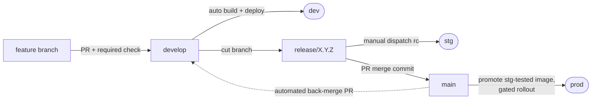

# GCP CI/CD Pipeline Template


[](https://github.com/avlon-technologies/template-gcp-cicd/actions/workflows/on-pr.yml)
[](https://github.com/avlon-technologies/template-gcp-cicd/actions/workflows/on-develop.yml)

A production-grade CI/CD pipeline template for **GitHub Actions → Google Cloud Run**, demonstrated with a minimal .NET 10 web API. Clone it, swap in your own application, and get environment promotion (dev → stg → prod), build-once-promote-many container images, gated production rollouts, and secretless Google Cloud authentication — without designing the pipeline yourself.

## Why this template exists

Most CI/CD examples stop at "build and deploy on push." Real delivery pipelines have to answer harder questions:

- How do I guarantee production runs **the exact binary** QA tested — not a rebuild of the same commit?
- How do I deploy to Google Cloud **without storing cloud credentials** in GitHub?
- How do I know a deploy actually worked — and that the *right build* is serving?
- How do I roll back in seconds when a release goes wrong?
- How do hotfixes reach production without dragging in unreleased work?

This template answers all of them with plain GitHub Actions workflows you can read, adapt, and audit. The sample application is deliberately trivial (one greeting endpoint) — the pipeline is the product.

## Key features

- **Environment promotion** — dev (automatic on merge), stg (manually dispatched release candidates), prod (automatic on release merge), each mapped to its own Cloud Run service and GitHub environment.
- **Build once, promote many** — release-candidate builds are pushed to Artifact Registry and promoted by **immutable digest**, located via the image's `sha-<commit>` tag. Merging to `main` promotes the exact stg-tested image; the pipeline **refuses to rebuild untested source for prod**. Digests do not expire, so the rollback window is bounded by your registry retention policy rather than a 90-day artifact clock.
- **Verified deploys** — every deploy ends with a smoke test that asserts both the health endpoint *and* that the app reports the intended build label (stamped into the assembly at build time, exposed via OpenAPI).
- **Gated production rollouts** — the revision is deployed with **no traffic** behind a preview tag, smoke-tested on its own URL, then given 100% of traffic. A failed post-shift smoke test automatically returns traffic to the previously serving revision.
- **Secretless Google Cloud auth** — OIDC Workload Identity Federation with one scoped deploy service account per environment. There are no repository secrets at all.
- **Full release lifecycle** — gitflow-style release, hotfix, and support branches; automatic version detection from merge commits; immutable `build/<env>/<label>` audit tags; GitHub Releases; automated back-merge/backport PRs to `develop`.
- **Hardened workflows** — actions pinned to commit SHAs (Dependabot-maintained), least-privilege job permissions, injection-safe input handling, per-environment concurrency groups.

## How a change reaches production



1. Features merge to `develop` via PR (build + test is a required check) and deploy to **dev** automatically.
2. A release branch (`release/1.2.0`) is cut; pushes to it build only. A release coordinator dispatches the pipeline with an rc label (`1.2.0-rc.1`) to deploy to **stg**, which tags the commit `build/stg/1.2.0-rc.1` on success.
3. Merging the release PR to `main` (merge commit required) extracts the version, verifies a green staging deploy exists, promotes that exact image digest to **prod** via a gated rollout, tags `build/prod/1.2.0`, creates GitHub Release `v1.2.0`, and opens a back-merge PR to `develop`.

Hotfix (`hotfix/*`) and support (`support/*`) branches follow the same stg-then-prod path, cut from `main` instead of `develop`. Full operator procedures: [docs/operations-manual.md](docs/operations-manual.md).

## Repository structure

```
.
├── .github/
│   ├── workflows/
│   │   ├── _build.yml           # Reusable: build, test, publish, stamp label, push image to Artifact Registry
│   │   ├── _deploy.yml          # Reusable: WIF login, deploy revision (optionally gated), smoke test, tag
│   │   ├── _hotfix-support.yml  # Reusable: shared hotfix/support pipeline logic
│   │   ├── on-pr.yml            # PRs to develop/main → build + test (required check) + source-branch guard
│   │   ├── on-develop.yml       # develop → dev (automatic)
│   │   ├── on-release.yml       # release/**, milestone/** → stg (deploy is dispatch-gated)
│   │   ├── on-hotfix.yml        # hotfix/** → stg (deploy is dispatch-gated)
│   │   ├── on-support.yml       # support/** → stg (deploy is dispatch-gated)
│   │   ├── on-main.yml          # main → prod (digest promotion, gated rollout, release, back-merge)
│   │   └── show-oidc-token.yml  # Educational: inspect the OIDC JWT GitHub mints for a job
│   └── dependabot.yml           # Weekly NuGet + Actions SHA-pin updates
├── Api/                         # Sample .NET 10 minimal API (replace with your app)
├── Api.Test/                    # xUnit integration tests (WebApplicationFactory)
├── docs/                        # Guides, operations manual, C4 architecture docs
├── infra/                       # Terraform: Artifact Registry, WIF, Cloud Run per environment
├── Dockerfile                   # Packages the published output (does NOT rebuild — see comments)
├── Directory.Build.props        # Shared build settings (net10.0, nullable)
└── cicd-demo.sln
```

## Documentation

| Document | What it covers |
|---|---|
| [docs/getting-started.md](docs/getting-started.md) | End-to-end setup: Google Cloud resources, deploy identities, GitHub configuration, first deploy |
| [docs/customization.md](docs/customization.md) | Every file and value to change when adapting the template to your project |
| [docs/operations-manual.md](docs/operations-manual.md) | Day-to-day operations: releasing, hotfixing, rolling back, troubleshooting |
| [docs/workload-identity-federation.md](docs/workload-identity-federation.md) | How CI authenticates to Google Cloud with no stored secrets |
| [docs/ARCHITECTURE.md](docs/ARCHITECTURE.md) | C4 architecture documentation (context → containers → components → code) |
| [CONTRIBUTING.md](CONTRIBUTING.md) | How to contribute to the template itself |
| [SECURITY.md](SECURITY.md) | Security model and vulnerability reporting |

## Prerequisites

**To run the sample app locally:**

- [.NET 10 SDK](https://dotnet.microsoft.com/download)

**To deploy your own instance:**

- A Google Cloud project, with permission to create Artifact Registry repositories, Cloud Run services, service accounts, workload identity pools, and IAM bindings
- A GitHub repository (Actions enabled) where you have admin access — rulesets, environments, and Actions settings must be configured
- [Google Cloud CLI](https://cloud.google.com/sdk/docs/install) (`gcloud`) for identity setup; [GitHub CLI](https://cli.github.com/) (`gh`) is optional but used throughout the docs
- Provisioned Google Cloud infrastructure — one Cloud Run service per environment plus a shared Artifact Registry repository. Terraform for all of it lives in [`infra/`](infra/); any provisioning method works as long as the required resources exist.

## Quick start (local)

```sh
git clone https://github.com/avlon-technologies/template-gcp-cicd.git
cd template-gcp-cicd
dotnet run --project Api
```

Then browse `http://localhost:5018/swagger` (the port comes from `Api/Properties/launchSettings.json`). Run the tests with:

```sh
dotnet test
```

## Quick start (deploy your own)

Condensed from [docs/getting-started.md](docs/getting-started.md), which has the full commands:

1. **Get the code** — use this repo as a template (or fork/clone) into your own GitHub repository, with `develop` as the default branch.
2. **Provision Google Cloud** — a shared Artifact Registry repository, and one Cloud Run service per environment.
3. **Create deploy identities** — a Workload Identity Pool provider scoped to your repository, one deploy service account per environment bound to `attribute.environment/<env>`, and a build service account for pushing images. See [workload identity federation](docs/workload-identity-federation.md).
4. **Configure GitHub** — create the `dev`, `stg`, `prod` environments and set the variables and settings below.
5. **Customize** — work through [docs/customization.md](docs/customization.md) (project names, service names, the smoke-test contract).
6. **Deploy** — merge or push to `develop`; the pipeline builds, tests, deploys to dev, and smoke-tests the result.

## Required GitHub configuration

There are deliberately **no repository secrets** — Google Cloud authentication is OIDC-based. Everything below is a variable or a setting.

### Repository variables

Settings → Secrets and variables → Actions → Variables:

| Variable | Value | Used by |
|---|---|---|
| `WIF_PROVIDER` | Full resource path of the Workload Identity Pool provider (uses the project **number**) | `_build.yml`, `_deploy.yml` |
| `BUILD_SERVICE_ACCOUNT` | Service account that pushes images | `_build.yml`, promotion lookups |
| `AR_LOCATION` | Artifact Registry region, e.g. `northamerica-northeast1` | `_build.yml` |
| `AR_PROJECT_ID` | Project holding the registry | `_build.yml` |
| `AR_REPOSITORY` | Artifact Registry repository name | `_build.yml` |
| `IMAGE_NAME` | Image name within the repository | `_build.yml` |

None of these are credentials — they are addressing information, safe as plain variables. The credential is minted per job by [workload identity federation](docs/workload-identity-federation.md).

### Environments and environment variables

Settings → Environments — create `dev`, `stg`, and `prod`, each with:

| Variable | Value |
|---|---|
| `DEPLOY_SERVICE_ACCOUNT` | That environment's deploy service account |
| `GCP_PROJECT_ID` | Project hosting that environment's Cloud Run service |
| `GCP_REGION` | Region of that service |
| `SERVICE_NAME` | Cloud Run service name |
| `RUNTIME_SERVICE_ACCOUNT` | *(optional)* Identity the container runs as |
| `GATEWAY_URL` | *(optional)* Smoke-test URL when the service is not reachable on its `run.app` hostname |

The deploy job's `environment:` declaration scopes these variables, so the entry workflows carry no per-environment configuration. Optionally add required reviewers on `prod` for a manual approval gate before production deploys.

### Repository settings

| Setting | Where | Value |
|---|---|---|
| Default branch | Settings → General | `develop` |
| Workflow permissions | Settings → Actions → General | Default token: **read-only** |
| Allow GitHub Actions to create and approve pull requests | Settings → Actions → General | **Enabled** (the back-merge/backport PRs need it) |
| Rulesets for `develop` and `main` | Settings → Rules | PR required; **build / Build & Test** check required; `main` additionally: merge commits only, **Guard main source branch** check required |

`main` must allow **merge commits only** — the prod pipeline reads the release version from the merge commit subject, and a squash or rebase merge breaks version detection *and* the back-merge.

## The workflows

Two reusable workflows (prefixed `_`) implement the mechanisms; branch-triggered entry workflows implement the policy:

| Workflow | Trigger | What it does |
|---|---|---|
| `on-pr.yml` | PRs to `develop`/`main` | Build + test (the required check); guards that PRs into `main` come from `release/*`, `hotfix/*`, or `support/*` |
| `on-develop.yml` | Push to `develop`; manual dispatch | Build, test, deploy to **dev**. Dispatch input `build-label` rebuilds HEAD stamped with a previous dev label (deploy retry) |
| `on-release.yml` | Push to `release/**`, `milestone/**`; manual dispatch | Pushes build only. Dispatch deploys the branch head to **stg**, reusing the image the push build already produced |
| `on-hotfix.yml` / `on-support.yml` | Push to `hotfix/**` / `support/**`; manual dispatch | Same dispatch-gated stg pattern, for branches cut from `main` |
| `on-main.yml` | Push to `main`; manual dispatch | Promote the stg-tested image digest to **prod** (gated rollout), tag, create the GitHub Release, open the back-merge PR. Dispatch input `version` redeploys/rolls back to any released version still present in the registry |
| `_build.yml` | Called | Restore, build (stamping the label into `InformationalVersion`), test (published as a PR check), publish, and — when `push-image` is set — build and push the image, returning its digest |
| `_deploy.yml` | Called | WIF login, deploy the image by digest (direct, or no-traffic→smoke→shift for prod), smoke-test, write run summary, tag the deployment |
| `show-oidc-token.yml` | Manual dispatch | Prints the decoded OIDC token claims for learning/debugging (minted with a throwaway audience, so it can't be exchanged for access) |

Deploys to the same environment serialize via concurrency groups (`deploy-dev` / `deploy-stg` / `deploy-prod`); superseded PR builds are cancelled.

## Verification, rollback, and troubleshooting

- Every deploy smoke-tests `GET /v1/hello` **and** asserts `/openapi/v1.json` reports the deployed build label — "green" means the right build is actually serving.
- Every stg/prod deploy tags the built commit `build/<env>/<label>`; tags are immutable and are the promotion gate's proof that staging tested the build.
- **Instant prod rollback**: the previous revision stays live on Cloud Run with 0% traffic — one `gcloud run services update-traffic --to-revisions` brings it back. Rollback to any older released version is a `workflow_dispatch` away, and because promotion is by immutable digest there is no retention window to expire.
- A comprehensive symptom → cause table lives in the [operations manual's troubleshooting section](docs/operations-manual.md#troubleshooting).

## Security considerations

- **No stored cloud credentials.** Deploys authenticate via [OIDC workload identity federation](docs/workload-identity-federation.md); tokens are job-scoped, short-lived, and bound to a specific repo + GitHub environment.
- **Blast-radius isolation.** Each environment has its own deploy service account, bound to tokens carrying that environment's claim and holding `roles/run.developer` on *only* its own project — a compromised dev pipeline cannot touch prod.
- **Least-privilege tokens.** The default `GITHUB_TOKEN` is read-only; each job declares exactly the permissions it needs.
- **Supply-chain pinning.** All actions are pinned to full commit SHAs with a version comment, kept current by Dependabot.
- **Injection-safe workflows.** Workflow inputs reach shell scripts via `env:`, never by direct interpolation; version labels are charset-restricted because they become image tags and git tags.
- **Deliberate demo trade-off:** Swagger UI and the OpenAPI document are enabled in *all* environments, including prod, because this sample API has no sensitive surface. Revisit this for a real application — see [customization](docs/customization.md).

## Google Cloud resource naming

Resource names follow the org's engineering-standards handbook. Nothing is hardcoded in the workflows: names reach `_deploy.yml` only through each GitHub environment's `SERVICE_NAME`, `GCP_PROJECT_ID`, and `GCP_REGION` variables — see [customization](docs/customization.md). Adding a fourth environment therefore requires no workflow edits at all. The per-environment topology is described in [C2 — Containers](docs/c2-containers/README.md#deployment-topology-per-environment).

## Maintenance

- **Dependencies:** Dependabot ([config](.github/dependabot.yml)) opens weekly PRs for NuGet packages, Actions SHA pins, and Docker base images. When bumping an action manually, update the SHA **and** its `# vX.Y.Z` comment together.
- **.NET upgrades:** update `Directory.Build.props` (`TargetFramework`), the `dotnet-version` in `_build.yml`, package versions in the two `.csproj` files, and the base image in the `Dockerfile` — they must agree.
- **Template upgrades:** if you adopted this template, pull upstream workflow changes selectively — your customized values (names, URLs, smoke tests) live in the files listed in [customization](docs/customization.md), so diff those carefully.

## Contributing

Contributions are welcome — see [CONTRIBUTING.md](CONTRIBUTING.md) for the branch model, required checks, and workflow conventions (SHA-pinned actions, injection-safe inputs).

## License

This repository does not currently include a license file. Until one is added, the code is under default copyright — open an issue if you need clarity on reuse terms.
