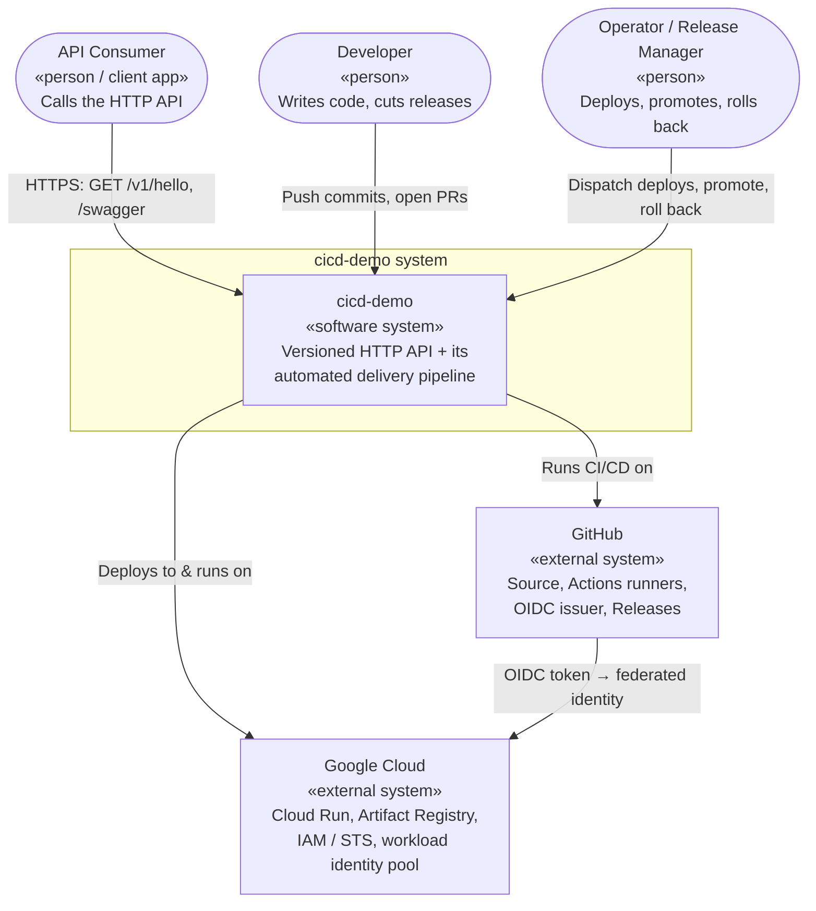

# C1 — System Context

The widest zoom: **cicd-demo** as a single box, the people and systems that interact with it, and the boundary that separates "our system" from "the world."

← [Back to Architecture overview](../ARCHITECTURE.md) · Next: [C2 — Containers](../c2-containers/README.md)

## Diagram

## People (actors)

| Actor | Role | Interactions |
|---|---|---|
| **API Consumer** | Any HTTP client — a browser, a downstream service, a smoke-test script. | Calls `GET /v1/hello` for the greeting; browses `/swagger` for interactive docs; the platform health probe calls `/healthz`. |
| **Developer** | Writes application code and tests. | Pushes to feature branches, opens PRs to `develop`/`main`. Never deploys to prod directly — features reach production only through a release. |
| **Operator / Release Manager** | Owns the path to production. | Cuts release/hotfix/support branches, dispatches staging deploys, merges release PRs (which auto-promote to prod), and performs rollbacks. Often the same person as the developer in a small team, but a distinct *role*. |

## External systems (dependencies)

| System | What we use it for | Why it's a dependency, not part of our system |
|---|---|---|
| **GitHub** | Source control, pull requests + branch rulesets (the quality gates), Actions (CI/CD compute), the OIDC token issuer for cloud auth, and GitHub Releases. | We consume it as a platform; we configure it but don't operate it. |
| **Google Cloud** | The runtime and the registry: Cloud Run hosts the API (one service per environment, served at its `run.app` URL or through a gateway), Artifact Registry stores the promotable container images, and IAM + the Security Token Service authorize deploys via workload identity federation. | Managed cloud services; provisioned outside this repo, not built by us. |

## System boundary — what's in, what's out

**Inside the boundary** (this repo owns and specifies it):
- The API application and its tests.
- The packaging-only `Dockerfile` that turns the tested publish output into the image that ships.
- The CI/CD pipeline (build, test, publish, push image, deploy, promote, tag, release, back-merge).
- The contract each deploy must satisfy (smoke test + version assertion).

**Outside the boundary** (depended upon, specified elsewhere):
- The Google Cloud runtime topology — projects, the Artifact Registry repository, the Cloud Run services, the workload identity pool/provider, and the build/deploy/runtime service accounts — is provisioned outside this repo; the required shape is documented in [getting-started.md](../getting-started.md). Deploys fail until that infrastructure exists for the target environment.
- GitHub repository settings (rulesets, workflow permissions, environment variables, the prod environment's reviewers and deployment branch policy) — configured in the GitHub UI, documented in the [operations manual](../operations-manual.md), not code in this repo.

## Environments

The single system is realized as **three isolated environments**, each a full copy of the runtime, differing only by configuration:

| Environment | Purpose | How code arrives |
|---|---|---|
| **dev** | Continuous integration target; latest `develop`. | Automatic on merge/push to `develop`. |
| **stg** | Release-candidate verification (QA/UAT). | Manual dispatch of a release/hotfix/support pipeline. |
| **prod** | Live, user-facing. | Automatic on merge to `main`, via gated-rollout promotion of the stg-tested image digest. |

Environment isolation is a **security boundary**: each environment has its own Cloud Run service and its own deploy service account, and that service account can only be impersonated by a job running in the matching GitHub environment. A compromise of the dev deploy path cannot touch prod. Environments may also live in separate GCP projects — the workflows read `GCP_PROJECT_ID` per environment and keep it separate from `AR_PROJECT_ID`, so the registry can be shared while the runtimes are not.

## Key decisions at this level

- **The pipeline is part of the system, not scaffolding around it.** The reference value of this project is the delivery mechanism, so it lives inside the boundary and is specified with the same rigor as the app.
- **Three-environment promotion model.** dev (integration) → stg (verification) → prod (live) with progressively stricter gates. Prevents untested code from reaching users while keeping dev fast.
- **The registry is shared across environments; the runtimes are not.** One Artifact Registry repository holds every image the pipeline ever builds, because "the digest dev ran is the digest prod runs" is only possible if there is one place the image lives. Isolation is enforced by IAM and by separate Cloud Run services, not by separate registries.
- **GitHub and Google Cloud are federated, not secret-coupled.** GitHub issues short-lived OIDC tokens that GCP's STS exchanges for access tokens, subject to a per-repository attribute condition and per-environment IAM bindings. There is no shared secret and no service-account key between the two external systems. This is a deliberate context-level choice that shapes every deploy interaction below.
</content>
