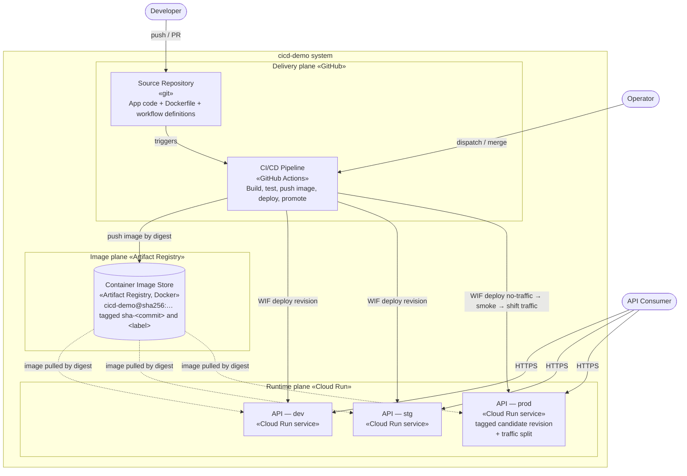
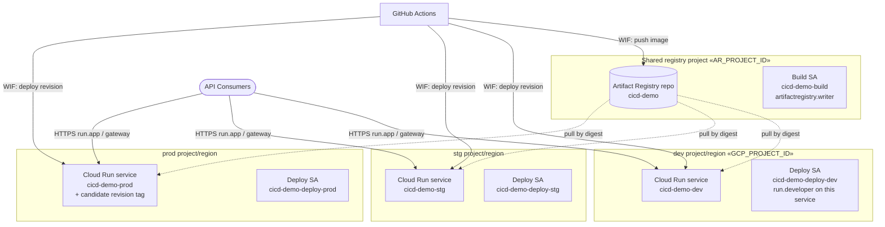

# C2 — Containers

Zooming into the system boundary: the separately deployable / runnable / configurable units ("containers" in C4 terms). On this platform a C4 container happens to ship *as* a Docker container image — the two senses of the word coincide here, but they are not the same concept.

← [C1 — Context](../c1-context/README.md) · [Architecture overview](../ARCHITECTURE.md) · Next: [C3 — Components](../c3-components/README.md)

## Diagram

The system splits into three **planes**: a **delivery plane** (how code becomes a verified image), an **image plane** (the durable, immutable thing that gets promoted), and a **runtime plane** (what actually serves traffic). Most of the architecture's substance is in the delivery plane.

## Containers

### Delivery plane (GitHub)

| Container | Technology | Responsibility |
|---|---|---|
| **Source Repository** | Git on GitHub | Holds the application code, tests, the packaging `Dockerfile`, and the workflow definitions that *are* the pipeline. Branch rulesets enforce PR-only merges and required checks — the quality gate lives here. |
| **CI/CD Pipeline** | GitHub Actions (reusable + entry workflows) | Builds, tests, publishes, packages and pushes the image, deploys, promotes, tags, releases, and back-merges. Decomposed in [C3](../c3-components/README.md). |

### Image plane (Google Cloud)

| Container | Technology | Responsibility |
|---|---|---|
| **Container Image Store** | Artifact Registry (Docker format), one repository shared by all environments | Holds every image the pipeline builds. Each push carries two human-legible tags (`sha-<commit>` and the build label) but the **promotable identity is the digest** — `LOCATION-docker.pkg.dev/PROJECT/REPO/NAME@sha256:…`. **This store is what makes "build once, promote many" possible**: prod runs the exact digest stg tested. Digests never expire, so unlike a build-artifact store there is no retention window to lapse — the only way to lose a promotable image is to delete it. |

The image itself is **packaging-only**: `Dockerfile` copies `./publish` produced by the CI build rather than building from source. That is load-bearing — the binary inside carries the `InformationalVersion` the tests ran against and the smoke test later asserts. A Dockerfile that rebuilt from source would silently break both properties. The cost is that `docker build .` on a clean checkout fails; that is intentional.

### Runtime plane (Google Cloud)

| Container | Technology | Responsibility |
|---|---|---|
| **API — dev / stg** | Cloud Run service, one per environment | Runs the image. Each deploy creates a new **revision** that immediately takes 100% of traffic. Served at the service's `run.app` URL (or, when the environment sets `GATEWAY_URL`, through a load balancer in front of it). |
| **API — prod** | Cloud Run service with tagged revisions + traffic splitting | Same image, deployed with `--no-traffic --tag cand-<run-id>`: the candidate revision gets a stable preview URL, is smoke tested there, and only then receives 100% of traffic. The previously serving revision remains available for an immediate traffic shift back. |

The **API application itself is a single container** — one Kestrel process per revision, listening on port 8080 (pinned in both the `Dockerfile` and the `--port 8080` deploy flag, and matching Cloud Run's own default). Its internal structure is the subject of [C3](../c3-components/README.md).

## Communication

| From → To | Protocol | Notes |
|---|---|---|
| Consumer → Cloud Run service | HTTPS | Public traffic, to the service's `run.app` URL or the environment's `GATEWAY_URL`. |
| Pipeline → Artifact Registry | Docker registry API (`docker buildx --push`, `gcloud artifacts docker images list`) | Authenticated by short-lived federated token, not a stored key. |
| Pipeline → Cloud Run | Cloud Run Admin API (via `gcloud run deploy` / `update-traffic`) | Authenticated by short-lived federated token. IAM-gated, **not** IP-gated — deploys need no special network position. |
| Cloud Run → Artifact Registry | Image pull by digest | Performed by the *runtime project's Cloud Run service agent*, not the deploy identity — a cross-project split needs that agent granted registry read. |
| Repository → Pipeline | GitHub event triggers | Push, PR, and `workflow_dispatch`. |

## Deployment topology per environment

Each environment is a self-contained stamp: a Cloud Run service `cicd-demo-<env>` in its environment's GCP project and region, and its own deploy service account `cicd-demo-deploy-<env>@…` holding `roles/run.developer` on *only* that service plus read on the shared registry. Optionally the container runs as a per-environment runtime service account. A single **build** service account, shared across environments, holds `roles/artifactregistry.writer` on the one repository and nothing else — it can push images and cannot deploy anything.

## Key decisions at this level

- **Delivery plane and runtime plane are separate systems, federated by OIDC.** GitHub compute never holds a Google Cloud credential; it presents a signed identity token that a workload identity provider accepts under an attribute condition, and per-environment IAM bindings decide which service account that token may become. Removes the single largest class of CI secrets.
- **The image store is a first-class container, not an implementation detail.** Making the tested binary a durable, immutable, digest-addressable object is what lets prod promote the *exact* stg-tested image instead of rebuilding from source. Rebuilding would reintroduce the risk the whole verification chain exists to remove.
- **Promotion is by digest, never by tag.** Tags (`sha-<commit>`, the build label) exist for humans and for lookup; every deploy input is `…@sha256:…`. A moved or reused tag therefore cannot change what ships.
- **Only prod pays for the gated rollout.** dev and stg deploy directly — the new revision takes traffic at once, and rollback is re-running a workflow. Prod deploys cold, verifies on a tagged URL, then shifts traffic, and returns traffic to the previously serving revision if the post-shift smoke test fails. The extra deploy latency is spent only where user-facing downtime matters.
- **No shared ingress, isolated stamps.** Each service is exposed directly at its `run.app` URL — no gateway to operate or share — while separate services and scoped deploy identities keep the environments' blast radius independent. An environment that *does* sit behind a load balancer sets `GATEWAY_URL` so the smoke test verifies the path users actually take.
</content>
