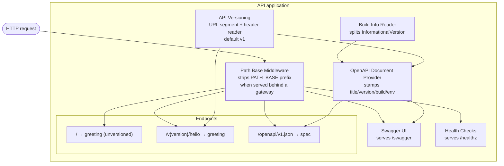
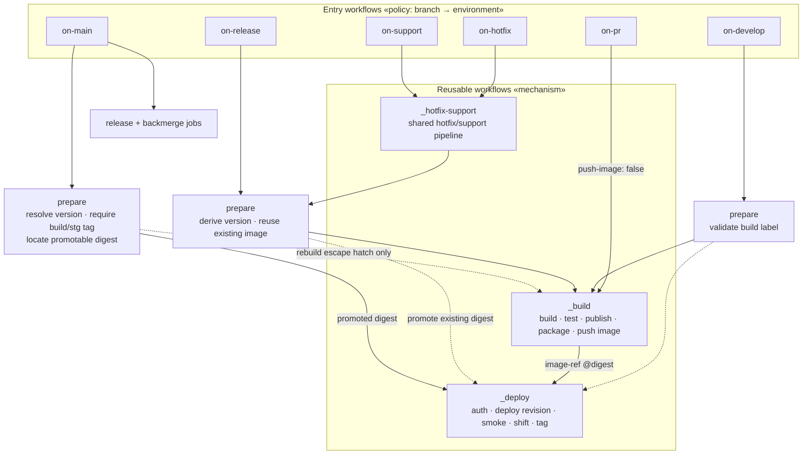
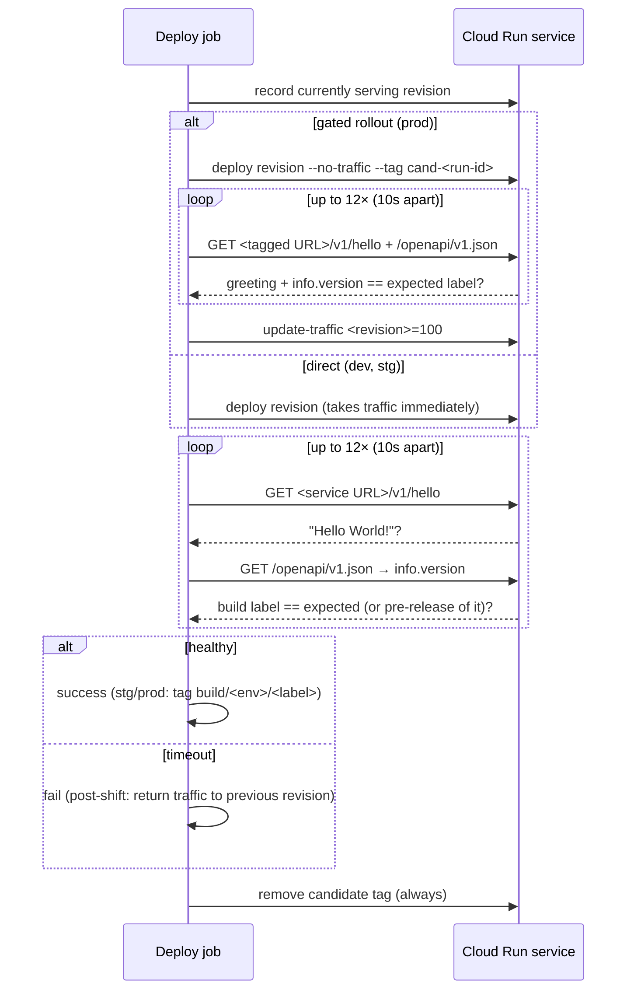

# C3 — Components

Zooming inside the two containers with meaningful internal structure: the **API application** and the **CI/CD pipeline**. A component is a grouping of related functionality behind a clear responsibility — not necessarily a separate file, but a distinct role.

← [C2 — Containers](../c2-containers/README.md) · [Architecture overview](../ARCHITECTURE.md) · Next: [C4 — Code](../c4-code/README.md)

---

## Part A — The API application

A single self-hosted ASP.NET Core (minimal API) process. Its components are the middleware/services configured at startup and the endpoints they expose.

### Diagram

### Components

| Component | Responsibility | Why it exists |
|---|---|---|
| **Build Info Reader** | On startup, reads the assembly's `InformationalVersion`, splits it into the build **label** and the **commit SHA** (the SDK appends `+<sha>`), and renders a commit link from the stamped `RepositoryUrl` metadata. | The running build must be self-identifying. The pipeline's smoke test asserts against exactly this value — it is the contract between app and pipeline. |
| **API Versioning** | Routes `/v{version}/…`, defaults to v1, also reads an `api-version` header, and reports supported versions. | Breaking changes ship as a *new* version served from the same deployment; old versions keep answering. The versioning scheme is an architectural commitment, not an afterthought. |
| **OpenAPI Document Provider** | Generates `/openapi/v1.json`, stamping the document title, the build label as the spec `version`, a commit-linked description, and the environment name — and clearing the `servers` entry so calls stay same-origin. | Makes the deployed build **observable over HTTP** — both humans (Swagger) and machines (the smoke test's `jq '.info.version'`) read it. |
| **Swagger UI** | Serves interactive docs at `/swagger` from the OpenAPI document, fetched by a *relative* path so it survives a gateway prefix. | Human-facing verification surface; enabled in *every* environment including prod (this API has no sensitive surface). |
| **Health Checks** | Serves `/healthz` as a dedicated liveness probe, decoupled from the greeting. | The platform/gateway probe needs a stable endpoint independent of business responses; dependency checks (Secret Manager, a database, …) register here and surface as Degraded/Unhealthy. |
| **Path Base Middleware** | When `PATH_BASE` is configured, strips that prefix from incoming requests; a no-op when unset. | A Cloud Run service reached through a load balancer under a path prefix (e.g. `/cicd-demo`) must serve the same routes as one reached directly at its `run.app` URL. |
| **Endpoints** | `/` (unversioned greeting), `/v1/hello` (versioned greeting), `/openapi/v1.json`, `/healthz`, `/swagger`. | The actual surface area. `/v1/hello` is the canonical smoke-test target. |

### The app↔pipeline contract

The two containers meet at one invariant: **the build label the pipeline intends to deploy must equal the `info.version` the running app reports** (or a pre-release of it). The Build Info Reader and OpenAPI Provider produce that value; the [Deploy pipeline](#part-b--the-cicd-pipeline) asserts it. This single contract is what turns "the deploy succeeded" into "the *right image* is actually serving."

---

## Part B — The CI/CD pipeline

Decomposed into **reusable workflows** (the mechanisms, prefixed `_`) composed by **entry workflows** (the branch-triggered policies).

### Diagram — the workflow call graph

Environment per path: `on-pr` deploys nothing; `on-develop` → **dev**; `on-release`, `on-hotfix`, `on-support` → **stg** (with `tag-deployment`); `on-main` → **prod** (with `gated-rollout` and `tag-deployment`).

### Components

| Component | Lives in | Responsibility |
|---|---|---|
| **Build & Test** | `_build.yml` | Restore, build (stamping the build label into `InformationalVersion` and the repo URL into assembly metadata), test (publishing results as a PR check), publish. Fails the run if any test fails. Emits `build-label`. |
| **Package & Push** | `_build.yml`, guarded by `push-image` | Only when the caller asks for it: authenticate via WIF as the *build* service account, `docker buildx build --push` the packaging Dockerfile, and emit the resulting **`image-digest`** and digest-pinned **`image-ref`**. PR validation leaves `push-image: false` and produces nothing deployable. |
| **Deploy** | `_deploy.yml` | Authenticate via WIF as the environment's *deploy* service account, record the currently serving revision, deploy the image by digest (direct, or no-traffic → tagged-URL smoke → traffic shift for a gated rollout), **smoke-test** (`/v1/hello` + version assertion), clean up the candidate tag, print the run-summary card, and tag the deployed commit. Returns traffic to the previous revision on a failed post-shift smoke test. |
| **Version resolution & validation** | `prepare` jobs in `on-develop.yml`, `on-release.yml`, `_hotfix-support.yml`, `on-main.yml` | Turn a branch + optional input into a build label. Release/hotfix/support labels are **commit-derived** (branch version + `git rev-list --count`), so the same commit always yields the same label. Rejects a ref that doesn't match the workflow's branch kind, and rejects labels outside the safe charset (they become image tags and git tags). |
| **Image reuse & promotion gating** | `prepare` jobs (`Locate existing … image` / `Locate promotable release image`) | On a stg dispatch: find the image already pushed for this commit by its `sha-<commit>` tag and skip the build; the label stamped in the image wins over a freshly derived one. On merge to `main`: resolve the release-branch head (the merge commit's second parent), **require a `build/stg/*` tag on it** — proof of a green staging deploy, since the image itself is pushed *before* any deploy — and only then hand its digest to `_deploy`. A missing tag or missing image **fails the prod run** rather than rebuilding untested source. |
| **Branch policy** | entry workflows (`on-*.yml`) | Map trigger branch → environment, wire concurrency groups (serialize deploys per env; the three stg pipelines share `deploy-stg` on dispatch), guard `main` PR sources, and grant the union of permissions the nested reusable workflows request. This is where "develop is auto-deployed but release is dispatch-gated" is decided. |
| **Release finalization** | `on-main.yml` `release` + `backmerge` jobs | After a release merge: create the GitHub Release `vX.Y.Z`, and bring the changes back to `develop` — a back-merge PR for `release/*` sources, a cherry-pick onto `backport/<version>` for `hotfix/*` and `support/*` (whose history is foreign to `develop`). `backmerge` runs *parallel* to `deploy`, so `develop` is not held hostage by a prod approval gate. |

### Branch → environment mapping

| Entry workflow | Branches | Environment | Deploy trigger |
|---|---|---|---|
| `on-pr.yml` | PRs to `develop`/`main` | — (build/test only, `push-image: false`) | the required check |
| `on-develop.yml` | `develop` | dev | automatic on push |
| `on-release.yml` | `release/**`, `milestone/**` | stg | push builds + pushes an image; **deploy dispatch-gated** |
| `on-hotfix.yml` / `on-support.yml` → `_hotfix-support.yml` | `hotfix/**` / `support/**` | stg | push builds + pushes an image; **deploy dispatch-gated** |
| `on-main.yml` | `main` | prod | automatic on merge (gated rollout, promoting the stg-tested digest) |

### The deploy pipeline's verification contract

Every deploy — dev, stg, and prod — ends the same way. Prod additionally runs the same contract *before* traffic moves:

A version mismatch is treated as "not ready yet" (the old revision may still be serving while the new one warms up) and only fails on timeout — which also cleanly handles the traffic-shift propagation window.

## Key decisions at this level

- **Mechanism vs. policy split.** `_build`/`_deploy` know *how*; `on-*` workflows know *when/where*. `_hotfix-support.yml` is the same idea one level up: hotfix and support are the same pipeline with a different branch prefix, so they share one definition instead of two near-identical copies. New branch flows reuse the mechanisms without duplicating deploy logic, and the deploy contract (smoke test, tagging, traffic rollback) is defined once.
- **Version identity is threaded end-to-end.** The label is chosen at build, compiled into the binary, baked into the image, asserted at deploy, and written as an immutable tag. There is no point in the pipeline where "which build is this?" is ambiguous — and where a reused image and a freshly derived label disagree, the *stamped* label wins, because the binary is what will report itself.
- **The promotable identity is the digest, not the artifact reference.** Every hand-off between jobs passes `…@sha256:…`. Because digests are immutable and Artifact Registry images do not expire, the "artifact expired, must rebuild" failure mode simply does not exist; a missing image means it was never built or was deliberately deleted.
- **Promotion is gated on proof, not trust.** An image existing is *not* evidence staging tested it — the image is pushed at build time, before any deploy. Only a `build/stg/*` tag, created after a stg smoke test passes, unlocks prod. "Stg-tested" is a verified fact recorded in git.
- **Gated rollout and traffic rollback are component responsibilities, not an operator's.** The pipeline verifies the candidate on its own URL before users can reach it, and restores the previously serving revision on a failed post-shift smoke test. Recovery doesn't wait for a human. The rollback is guarded on traffic having actually moved — a candidate that failed *before* the shift never took traffic and must not trigger one.
</content>
